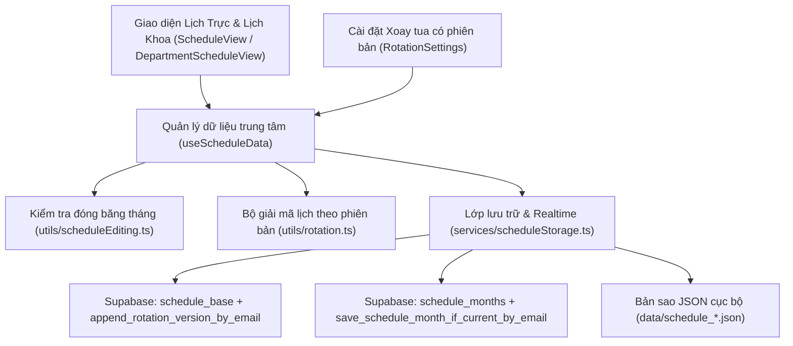

# ARCHITECTURE_MAP.md — Lịch Trực Khối Ngoại

## Overview

Ứng dụng web quản lý và xuất bản **Lịch Trực Khối Ngoại** và **Lịch Phân Công Khoa CTCH** (PKĐK, PKDV, Ứng trực) cho bệnh viện. Hệ thống hỗ trợ xoay tua định kỳ 4 tua theo phiên bản có ngày hiệu lực (`rotationConfig`), kiểm tra an toàn nghỉ ngơi sau trực 24h, tiếp nhận đề xuất đổi/nghỉ trực, xuất PDF và lịch cá nhân `.ics`, đồng thời đóng băng tự động các tháng đã chốt trên cả giao diện lẫn cơ sở dữ liệu Supabase.

## Architecture Diagram

## Blast Radius Matrix

| Thành phần                                                                 | Tác động trực tiếp khi thay đổi                                                                                       | Mức độ rủi ro & Lưu ý an toàn                                                                                                             |
| -------------------------------------------------------------------------- | --------------------------------------------------------------------------------------------------------------------- | ----------------------------------------------------------------------------------------------------------------------------------------- |
| `utils/scheduleEditing.ts` & RPC `save_schedule_month_if_current_by_email` | Chặn hoặc mở quyền chỉnh sửa lịch trực ngày và lịch phân công khoa theo từng tháng (giờ Việt Nam `Asia/Ho_Chi_Minh`). | **Cao** — Phải luôn đồng bộ khóa giữa giao diện client và hàm RPC trên Supabase để tránh lệch trạng thái đóng băng.                       |
| `utils/rotation.ts` & RPC `append_rotation_version_by_email`               | Tính toán danh sách bác sĩ trực cho mọi tháng từ `2026-11` trở đi và kiểm tra cảnh báo trực 2 ngày liên tiếp.         | **Rất cao** — Tuyệt đối không sửa điểm neo chu kỳ gốc hoặc ghi đè cấu hình các tháng đã chốt (`effectiveDate >= earliestRotationDate()`). |
| `hooks/useScheduleData.ts`                                                 | Điều phối tải dữ liệu cache-first, tự động lưu (debounced CAS), kiểm tra khóa chỉnh sửa và đồng bộ realtime.          | **Cao** — Lưu dữ liệu tháng trước khi lưu cấu hình chung; bảo toàn snapshot của các tháng lịch sử (`<= 2026-10`).                         |
| `utils/export/pdf.ts` & `utils/icsExport.ts`                               | Xuất bảng lịch trực PDF in ấn A4 ngang và xuất file `.ics` vào điện thoại cá nhân.                                    | **Trung bình** — Đảm bảo bố cục không tràn trang khi số tuần hoặc danh sách bác sĩ tăng.                                                  |

## Known Issues & Key Decisions (Hồ sơ Bệnh án Dự án)

- **Bảo toàn lịch trực các tháng cũ khi đổi thành viên hoặc xoay tua (`2026-10`):** Trước đây sửa danh sách bác sĩ/tua làm tính lại lịch cũ. Đã chuyển sang kiến trúc phiên bản chỉ-thêm (`rotationConfig.versions`) có `effectiveDate` bắt đầu từ tháng chưa chốt, kết hợp lưu `scheduleSnapshots` cố định cho các tháng lịch sử đến `2026-10`.
- **Mở và đóng băng lại lịch Tháng 11/2026 (`2026-11-01` → `2026-11-05`):** Ngày `01/11/2026`, hệ thống tạm mở ngoại lệ cho `2026-11` ở cả `utils/scheduleEditing.ts` và RPC `save_schedule_month_if_current_by_email` để hoàn tất phân công tháng 11. Ngày `05/11/2026`, sau khi chốt xong lịch tháng 11, đã gỡ ngoại lệ trên cả giao diện lẫn Supabase (`20261105162209_refreeze_november_2026_schedule_edits`), sao lưu `data/schedule_2026_11.json`, khóa chặt tháng 11 và mở sẵn tháng 12/2026 để xếp lịch.
- **Chống trôi thời gian thực trong bộ kiểm thử `RotationSettings.test.tsx` (`2026-11-05`):** Các bài test tạo phiên bản mẫu tháng `2026-11` từng phụ thuộc đồng hồ hệ thống thực nên tự gãy khi bước sang tháng 11. Đã cố định mốc thời gian giả lập (`vi.setSystemTime`) trong `RotationSettings.test.tsx` và bổ sung kịch bản kiểm tra khóa tháng 11 / mở từ `01/12/2026`.
